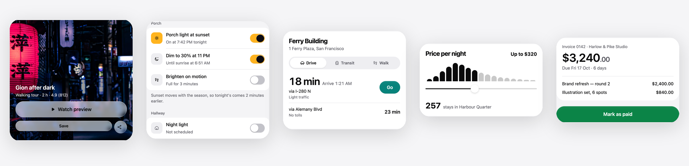

<p align="center">
  <a href="https://lumioui.com"></a>
</p>

<h1 align="center">LumioUI</h1>

<p align="center">
  <strong>Animated React Native components and 3,072 icons for Expo.</strong><br>
  Copied into your app as source you own. Haptics, reduced motion and accessibility built in.
</p>

<p align="center">
  <a href="./LICENSE"></a>
  <a href="https://www.npmjs.com/package/@lumioui/cli"></a>
  
  <a href="https://github.com/lumioui/lumioui/actions/workflows/ci.yml"></a>
</p>

<p align="center">
  <a href="https://lumioui.com/components"><strong>Live demos</strong></a> ·
  <a href="https://lumioui.com/icons">Icons</a> ·
  <a href="https://lumioui.com/docs/installation">Docs</a> ·
  <a href="https://x.com/LumioUI">X</a>
</p>

<p align="center">
  <a href="https://lumioui.com/components"></a>
</p>

## Quick start

In an Expo app:

```bash
npx @lumioui/cli init           # NativeWind, the theme and a ThemeProvider
npx @lumioui/cli add button     # copies the source into ./components/ui
```

```tsx
import { Button } from "./components/ui/button";

export default function Screen() {
  return <Button onPress={() => {}}>Continue</Button>;
}
```

Add more with `npx @lumioui/cli add switch slider toast`, or browse them all with `npx @lumioui/cli list`.

## Why LumioUI

- **Source you own.** The CLI copies each component into your project. No runtime package to upgrade, nothing hidden: read it, change it, keep it.
- **Motion that answers the touch.** Presses, toggles and sheets run on one set of Reanimated springs, so the whole app moves the same way. Every result shows up on the thing you touched.
- **Feels native.** Haptics where the thumb expects them, gestures on the UI thread, 60 fps on continuous inputs like sliders and drags.
- **Accessible by default.** Roles, labels and states for screen readers, 44 pt touch targets, and full Reduce Motion support that keeps the feedback and drops the travel.
- **Light and dark, any accent.** Semantic theme tokens with NativeWind classes. Wrap a screen in `<Accent color="green">` to recolour it.
- **Runs everywhere.** iOS, Android and the web, in Expo Go, on the React Native version `create-expo-app` gives you today.

## Components

74 components, each with installable variants. Tap one for its live demo.

| Category | Components |
| --- | --- |
| Actions | [Button](https://lumioui.com/components/button) · [Button Group](https://lumioui.com/components/button-group) · [Chip](https://lumioui.com/components/chip) · [Dropdown Menu](https://lumioui.com/components/dropdown-menu) · [Fab](https://lumioui.com/components/fab) · [Like Button](https://lumioui.com/components/like-button) · [Toggle](https://lumioui.com/components/toggle) · [Toggle Group](https://lumioui.com/components/toggle-group) |
| Forms & Inputs | [Autocomplete](https://lumioui.com/components/autocomplete) · [Checkbox](https://lumioui.com/components/checkbox) · [Copy Field](https://lumioui.com/components/copy-field) · [Form](https://lumioui.com/components/form) · [Input](https://lumioui.com/components/input) · [Label](https://lumioui.com/components/label) · [Number Input](https://lumioui.com/components/number-input) · [Password Strength](https://lumioui.com/components/password-strength) · [Radio Group](https://lumioui.com/components/radio-group) · [Search Input](https://lumioui.com/components/search-input) · [Select](https://lumioui.com/components/select) · [Slider](https://lumioui.com/components/slider) · [Stepper](https://lumioui.com/components/stepper) · [Switch](https://lumioui.com/components/switch) · [Tag Input](https://lumioui.com/components/tag-input) · [Textarea](https://lumioui.com/components/textarea) |
| Navigation | [App Bar](https://lumioui.com/components/app-bar) · [Breadcrumb](https://lumioui.com/components/breadcrumb) · [Drawer](https://lumioui.com/components/drawer) · [Pagination](https://lumioui.com/components/pagination) · [Segmented Control](https://lumioui.com/components/segmented-control) · [Tabs](https://lumioui.com/components/tabs) · [Toolbar](https://lumioui.com/components/toolbar) |
| Feedback | [Alert](https://lumioui.com/components/alert) · [Empty State](https://lumioui.com/components/empty-state) · [Error State](https://lumioui.com/components/error-state) · [Loader](https://lumioui.com/components/loader) · [Progress](https://lumioui.com/components/progress) · [Progress Ring](https://lumioui.com/components/progress-ring) · [Skeleton](https://lumioui.com/components/skeleton) · [Status Dot](https://lumioui.com/components/status-dot) · [Success Seal](https://lumioui.com/components/success-seal) · [Toast](https://lumioui.com/components/toast) |
| Overlays | [Action Sheet](https://lumioui.com/components/action-sheet) · [Dialog](https://lumioui.com/components/dialog) · [Popover](https://lumioui.com/components/popover) · [Tooltip](https://lumioui.com/components/tooltip) |
| Data Display | [Animated Number](https://lumioui.com/components/animated-number) · [Avatar](https://lumioui.com/components/avatar) · [Avatar Group](https://lumioui.com/components/avatar-group) · [Badge](https://lumioui.com/components/badge) · [Data Table](https://lumioui.com/components/data-table) · [Icon](https://lumioui.com/components/icon) · [Image](https://lumioui.com/components/image) · [Paper Clip](https://lumioui.com/components/paper-clip) · [Polaroid](https://lumioui.com/components/polaroid) · [Postage Stamp](https://lumioui.com/components/postage-stamp) · [Sticker](https://lumioui.com/components/sticker) · [Tape](https://lumioui.com/components/tape) · [Text](https://lumioui.com/components/text) |
| Layout | [Accordion](https://lumioui.com/components/accordion) · [Card](https://lumioui.com/components/card) · [Collapsible](https://lumioui.com/components/collapsible) · [Divider](https://lumioui.com/components/divider) · [Glass](https://lumioui.com/components/glass) · [Grid](https://lumioui.com/components/grid) · [List](https://lumioui.com/components/list) · [Section Header](https://lumioui.com/components/section-header) · [Separator](https://lumioui.com/components/separator) · [Stack](https://lumioui.com/components/stack) |
| Mobile-Native | [Keyboard Avoiding](https://lumioui.com/components/keyboard-avoiding) · [Theme Toggle](https://lumioui.com/components/theme-toggle) · [Typing Indicator](https://lumioui.com/components/typing-indicator) |
| Signature | [Action Swap](https://lumioui.com/components/action-swap) · [Character](https://lumioui.com/components/character) · [Circle Reveal](https://lumioui.com/components/circle-reveal) |

## Icons

[3,072 icons](https://lumioui.com/icons) drawn on one 24 px grid, in regular, thin and bold, each with an animated version that tells you what it does (the bell rings, the trash opens).

- **React Native:** `npx @lumioui/cli add animated-icons`, then `<AnimatedIcon name="bell" animate="press" />`.
- **Anywhere else:** plain SVG files in [`packages/ui/src/animated-icons/svg`](./packages/ui/src/animated-icons/svg), including a sprite and SMIL-animated versions that move with no JavaScript.

## Agent skills

[`skills/`](./skills) teaches coding agents how motion should feel in a React Native app: review your animations, add haptics, and find the places motion would help. They work in any project.

## Run the playground

```bash
git clone https://github.com/lumioui/lumioui && cd lumioui
pnpm install
pnpm playground     # press w for web, i for iOS, a for Android
```

| Path | What |
| --- | --- |
| `packages/core` | Theme, colour and motion tokens, hooks (`useHaptic`, `usePressAnimation`, `useReducedMotion`…) and shared primitives |
| `packages/ui` | One folder per component: source, `meta.json`, demo and installable variants |
| `apps/playground` | An Expo app that previews every component and variant |

## Contributing

Bug reports, fixes and new variants are welcome. Read [CONTRIBUTING.md](./CONTRIBUTING.md) to get set up, and [AGENTS.md](./AGENTS.md) for the motion and code conventions.

If LumioUI saves you time, a star helps other React Native developers find it.

## License

[MIT](./LICENSE). The LumioUI name and mark aren't covered; see [TRADEMARK.md](./TRADEMARK.md).
